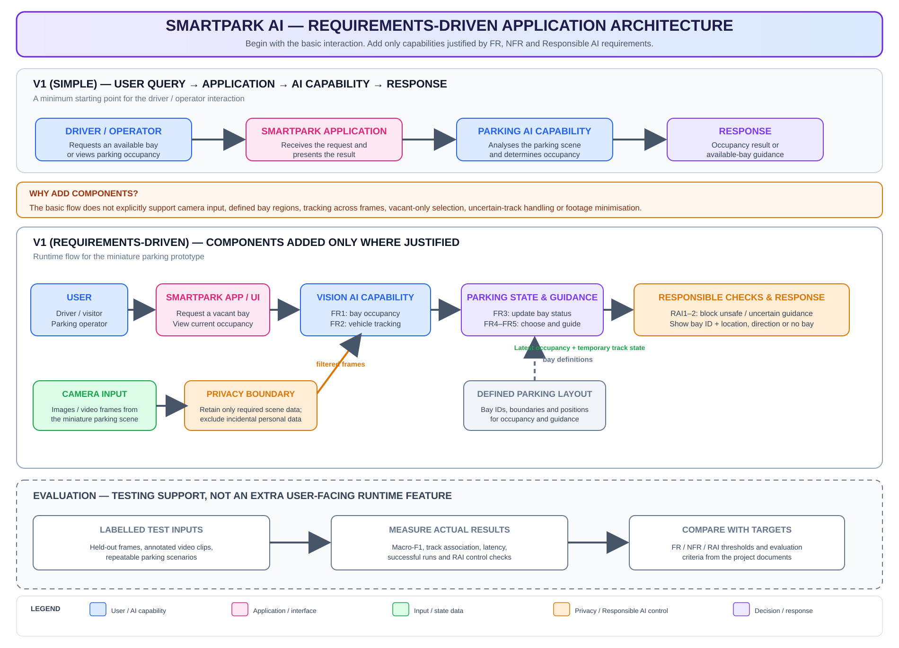

# Week 2 Architecture — SmartPark AI

**Project:** SmartPark AI — Computer Vision-Based Parking Occupancy Detection and Vehicle Tracking  
**Version:** 1.0  
**Architecture level:** Initial conceptual application architecture for the miniature parking prototype.

## 1. Start with the simplest architecture

The initial user interaction can be represented as:

```text
Driver / Operator → SmartPark Application → Parking AI Capability → Response
```

The driver or visitor requests an available parking bay, or the parking operator views occupancy. The application passes the task to the parking AI capability and presents the occupancy result or parking guidance.

This is a useful starting point, but it is not sufficiently explicit to support all requirements. The system also needs camera images or video, a defined miniature parking layout, vehicle tracking across frames, a way to maintain current bay/track state, vacant-only selection and responsible handling of uncertain results and captured footage.

## 2. Requirements-driven architecture



**Editable source:** [week2_architecture.drawio](week2_architecture.drawio)  
**Rendered diagram:** [week2_architecture.svg](week2_architecture.svg)

The extended architecture adds only the capabilities justified by the project requirements:

1. **Camera input:** supplies images or video frames from the miniature parking scene for FR1–FR3.
2. **Privacy boundary:** limits retained footage to what is needed for the prototype and excludes incidental personal information, supporting RAI3.
3. **Vision AI capability:** analyses the camera input for occupied/vacant bays and vehicle movement, supporting FR1 and FR2.
4. **Defined miniature parking layout:** provides bay identifiers, boundaries and positions so detections and guidance can refer to the correct bay, supporting FR1 and FR5.
5. **Current parking state:** represents the latest occupied/vacant/unknown status and temporary vehicle tracks; this supports occupancy updates and tracking continuity under FR2–FR3.
6. **Availability and guidance:** uses the latest parking state and layout to select a recorded vacant bay or report that no available bay is identified, supporting FR4–FR5.
7. **Responsible output checks:** excludes occupied or unknown bays from recommendations and withholds position-dependent guidance when a vehicle track is unconfirmed, supporting RAI1–RAI2.
8. **Response:** returns an occupancy view or the selected bay identifier and location/direction, or reports that no available bay is identified.

The evaluation area in the diagram is shown separately from the runtime flow. It represents the test process used to measure requirements, not another user-facing application feature.

## 3. Requirement traceability

| Requirement / objective | Architecture element | Why it is needed |
|---|---|---|
| FR1 / O1 — identify occupied and vacant bays | Camera input, vision AI capability, defined bay layout | The system needs visual input and bay boundaries to classify each defined parking bay. |
| FR2 / O2 — track vehicles across frames | Vision AI capability and current parking state | A temporary track must be maintained and updated as a vehicle moves through the observed scene. |
| FR3 / O1–O2 — update a bay when a vehicle enters or leaves | Current parking state and layout | Vehicle movement must be associated with the relevant marked bay so its status can be updated. |
| FR4 / O2 — return a vacant bay or report none | Availability and guidance | The system must select only a bay whose latest recorded status is vacant and handle the no-vacancy case. |
| FR5 / O2 — provide basic parking guidance | Defined layout, availability and guidance, response | The chosen bay identifier and location/direction must match the miniature layout. |
| NFR1 / O3 — frame-to-result latency | End-to-end processing flow and evaluation process | The time from frame receipt to result must be measured against the proposed latency threshold. |
| NFR2 / O1, O3 — occupancy classification correctness | Vision output and labelled test set | Predictions must be compared with manually labelled occupied/vacant ground truth. |
| NFR3 / O2, O3 — tracking consistency | Vehicle tracks and annotated test clips | Track associations must be compared with manual vehicle annotations. |
| NFR4 / O3 — operational reliability | Complete runtime flow and repeated test sequences | The full prototype must be tested for crashes, input loss and missing outputs. |
| RAI1 — misleading vacant status | Responsible output checks | Occupied and unknown bays must not be recommended as vacant. |
| RAI2 — incorrect vehicle position | Track state and responsible output checks | Unconfirmed or mismatched tracks must not be used for position-dependent guidance. |
| RAI3 — unnecessary personal information | Privacy boundary | Retained footage must be limited to the miniature scene needed for evaluation. |

## 4. What is deliberately not added yet

The current scope does not justify choosing a particular foundation model, object-detection framework, database, cloud service, camera model, authentication system, payment facility, GPS navigation service or autonomous vehicle-control component. These are implementation or additional product decisions, not necessary parts of the initial requirements-driven architecture. The hardware arrangement and processing platform remain to be decided.

## 5. Architecture boundary

This is a conceptual architecture for a controlled miniature parking prototype. It does not claim production deployment in a shopping centre or public car park. The system provides parking information and simple guidance; it does not identify real drivers, control vehicles or guarantee real-world parking availability.
