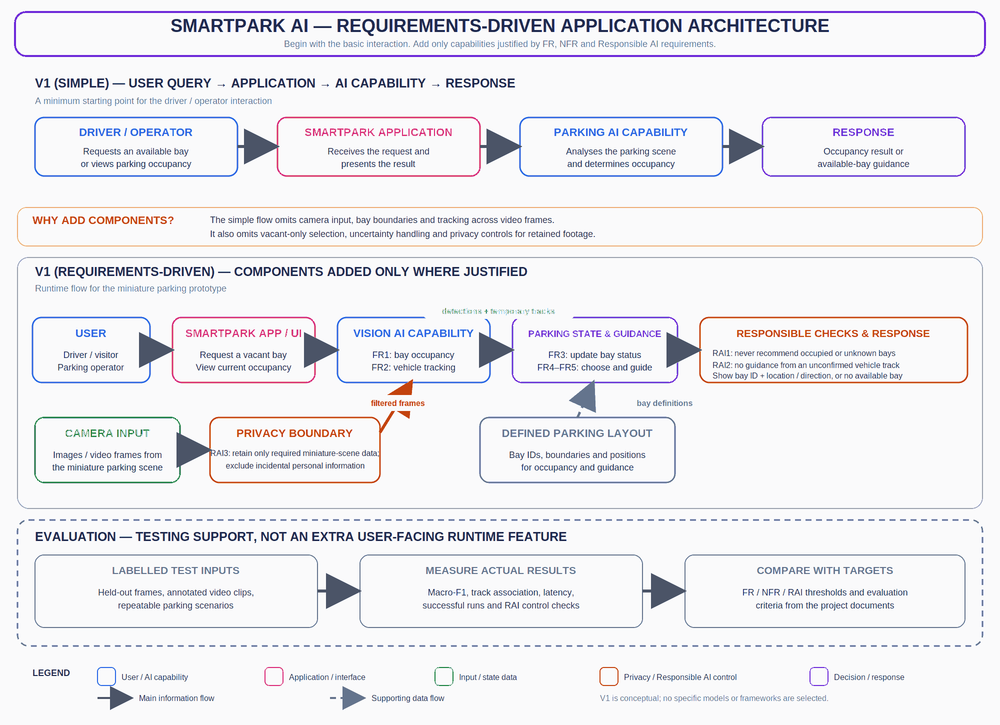

# Week 2 Architecture, Decisions and Traceability — SmartPark AI

**Project:** SmartPark AI — Computer Vision-Based Parking Occupancy Detection and Vehicle Tracking  
**Version:** 1.0  
**Architecture level:** Initial conceptual application architecture for the miniature parking prototype.


## 1. Start with the simplest architecture

The initial user interaction can be represented as:

```text
Driver / Operator → SmartPark Application → Parking AI Capability → Response
```

The driver or visitor requests an available parking bay, or the parking operator views occupancy. The application passes the task to the parking AI capability and presents the occupancy result or parking guidance.

This is a useful starting point, but it is not sufficiently explicit to support all requirements. The system also needs camera images or video, a defined miniature parking layout, vehicle tracking across frames, a way to maintain current bay/track state, vacant-only selection and responsible handling of uncertain results and captured footage.

## 2. Simple Architecture Requirement Check

The simple flow (Driver / Operator → SmartPark Application → Parking AI Capability → Response) is a useful starting point, but by itself it does not describe every behaviour and quality target in Part A or the evaluation criteria in Part B. The following check identifies what each important requirement needs and whether the simple flow is enough.

| Requirement ID | What does the requirement need? | Architecture Response |
|---|---|---|
| **FR1, NFR2, RAI1** — Occupancy detection and correctness | The system must classify each defined bay as occupied or vacant, achieve the proposed macro-F1 target, and avoid presenting an occupied or uncertain bay as vacant. | **Simple flow: not sufficient by itself.** Add **camera input** for image/video frames, a **defined parking-layout/bay map** to identify each bay, and a **vision occupancy capability**. Add a **responsible output check** so occupied or unknown bays cannot be recommended as vacant. Evaluate using held-out labelled frames, macro-F1 (target ≥ 0.90) and false-vacant events (target 0). |
| **FR2, NFR3, RAI2** — Vehicle tracking and uncertainty handling | The system must maintain a temporary track for each visible vehicle across frames, meet the proposed track-association target, and avoid position-dependent guidance when a track is uncertain or unconfirmed. | **Simple flow: not sufficient.** A one-off query-to-response flow does not represent continuity across video frames. Add **sequential video-frame input** and **temporary vehicle-track state** to maintain vehicle positions. Add a **track-confidence/uncertainty control** that marks lost or mismatched tracks as unconfirmed and blocks guidance based on them. Evaluate with annotated clips (tracking target ≥ 90%; zero guidance events from incorrect/unconfirmed tracks). |
| **FR3** — Bay occupancy updates | The system must update a bay's status when a tracked vehicle enters or leaves that defined bay, rather than treating a vehicle passing nearby as occupying it. | **Simple flow: not sufficient.** Add **bay-boundary mapping** and **parking-state update logic** that relates a tracked vehicle's position to a defined bay and records the occupied/vacant transition. |
| **FR4, FR5** — Availability selection and parking guidance | The system must select a bay whose latest status is vacant, report when no vacant bay is identified, and show the selected bay's identifier and location or a simple direction. | **Simple flow: partially sufficient.** It can represent a request and response, but it does not define how a safe bay is selected. Add **availability-selection and guidance capability** using the current parking state and defined layout. Exclude occupied and unknown bays; return a clear no-available-bay response when appropriate. Evaluate with controlled layout scenarios (target ≥ 95% correct decisions/guidance and zero occupied-bay recommendations). |
| **NFR1** — Processing latency | The system must return occupancy and vehicle-position results within the proposed 95th-percentile latency target of ≤ 2.0 seconds. | **Simple flow: sufficient as a high-level path, but not measurable on its own.** Add **measurement points/timestamps** at frame receipt and result availability, plus an evaluation process to calculate 95th-percentile latency over at least 100 frames. This is test instrumentation, not a new user-facing runtime feature. |
| **NFR4** — Operational reliability | The full prototype must complete repeated test sequences without crashing, losing its input stream or failing to provide an output. | **Simple flow: not sufficient to express the operational quality.** Add **input-stream/status monitoring** and clear handling of unavailable input or missing results, along with a **repeatable test process**. Evaluate at least 20 sequences; the proposed target is ≥ 95% successful runs (at least 19 of 20). |
| **RAI3** — Privacy and data minimisation | The system must retain only footage needed for the miniature parking evaluation and must not retain incidental identifiable people or unrelated personal information. | **Simple flow: not sufficient.** Add a **privacy boundary/data-handling control** around captured and retained footage: limit collection to the miniature scene, exclude or remove incidental personal information, and review retained samples. The proposed review threshold is zero privacy-violating retained files in the sample. |

**Decision:** Keep the simple user → application → AI capability → response flow as the overall starting point. Extend it with camera input, a defined bay layout, temporary tracking/parking state, availability and guidance logic, responsible output checks, and privacy handling because the requirements justify them. Use timestamps, monitoring and labelled test material to evaluate quality; do not turn every measurement activity into a separate runtime component.

---

## 3. Requirements-driven architecture




**Editable source:** [week2_architecture.drawio](week2_architecture.drawio)  
**PNG diagram:** [week2_architecture_v1.png](week2_architecture_v1.png)

The extended architecture adds only the capabilities justified by the project requirements:

1. **Camera input:** supplies images or video frames from the miniature parking scene for FR1–FR3.
2. **Privacy boundary:** limits retained footage to what is needed for the prototype and excludes incidental personal information, supporting RAI3.
3. **Vision AI capability:** analyses the camera input for occupied/vacant bays and vehicle movement, supporting FR1 and FR2.
4. **Defined miniature parking layout:** provides bay identifiers, boundaries and positions so detections and guidance can refer to the correct bay, supporting FR1 and FR5.
5. **Current parking state:** represents the latest occupied/vacant/unknown status and temporary vehicle tracks; this supports occupancy updates and tracking continuity under FR2–FR3.
6. **Availability and guidance:** uses the latest parking state and layout to select a recorded vacant bay or report that no available bay is identified, supporting FR4–FR5.
7. **Responsible output checks:** excludes occupied or unknown bays from recommendations and withholds position-dependent guidance when a vehicle track is unconfirmed, supporting RAI1–RAI2.
8. **Response:** returns an occupancy view or the selected bay identifier and location/direction, or reports that no available bay is identified.

The evaluation area in the diagram is shown separately from the runtime flow. It represents the test process used to measure requirements, not another user-facing application feature.

## 4. Requirement traceability

| Requirement / objective | Architecture element | Why it is needed |
|---|---|---|
| FR1 / O1 — identify occupied and vacant bays | Camera input, vision AI capability, defined bay layout | The system needs visual input and bay boundaries to classify each defined parking bay. |
| FR2 / O2 — track vehicles across frames | Vision AI capability and current parking state | A temporary track must be maintained and updated as a vehicle moves through the observed scene. |
| FR3 / O1–O2 — update a bay when a vehicle enters or leaves | Current parking state and layout | Vehicle movement must be associated with the relevant marked bay so its status can be updated. |
| FR4 / O2 — return a vacant bay or report none | Availability and guidance | The system must select only a bay whose latest recorded status is vacant and handle the no-vacancy case. |
| FR5 / O2 — provide basic parking guidance | Defined layout, availability and guidance, response | The chosen bay identifier and location/direction must match the miniature layout. |
| NFR1 / O3 — frame-to-result latency | End-to-end processing flow and evaluation process | The time from frame receipt to result must be measured against the proposed latency threshold. |
| NFR2 / O1, O3 — occupancy classification correctness | Vision output and labelled test set | Predictions must be compared with manually labelled occupied/vacant ground truth. |
| NFR3 / O2, O3 — tracking consistency | Vehicle tracks and annotated test clips | Track associations must be compared with manual vehicle annotations. |
| NFR4 / O3 — operational reliability | Complete runtime flow and repeated test sequences | The full prototype must be tested for crashes, input loss and missing outputs. |
| RAI1 — misleading vacant status | Responsible output checks | Occupied and unknown bays must not be recommended as vacant. |
| RAI2 — incorrect vehicle position | Track state and responsible output checks | Unconfirmed or mismatched tracks must not be used for position-dependent guidance. |
| RAI3 — unnecessary personal information | Privacy boundary | Retained footage must be limited to the miniature scene needed for evaluation. |

## 5. What is deliberately not added yet

The current scope does not justify choosing a particular foundation model, object-detection framework, database, cloud service, camera model, authentication system, payment facility, GPS navigation service or autonomous vehicle-control component. These are implementation or additional product decisions, not necessary parts of the initial requirements-driven architecture. The hardware arrangement and processing platform remain to be decided.

## 6. Architecture boundary

This is a conceptual architecture for a controlled miniature parking prototype. It does not claim production deployment in a shopping centre or public car park. The system provides parking information and simple guidance; it does not identify real drivers, control vehicles or guarantee real-world parking availability.

---

## 7. Architecture Decision Record (ADR)

### ADR-01 — Use camera-based visual input and a generic vision AI capability

| Decision | Requirement / Constraint | Alternatives Considered | Selected Option | Trade-off Accepted |
|---|---|---|---|---|
| Include camera-based vision input | FR1 requires occupied/vacant bay detection; FR2 requires vehicle detection and tracking across frames; NFR2 and NFR3 require measurable occupancy and tracking results. The project is a computer-vision prototype using a miniature parking layout. | Manual occupancy entry; separate sensors for each bay; camera input analysed by a generic vision AI capability. | **Camera input + generic Vision AI capability**, using images/video frames from the miniature scene. No specific model or camera technology is selected at this stage. | Camera-based analysis can support both occupancy detection and vehicle tracking using the same visual input, but it is sensitive to lighting, occlusion, camera position and image quality. These conditions must be included in testing. |

### ADR-02 — Maintain parking-layout and current parking-state information before selecting a bay

| Decision | Requirement / Constraint | Alternatives Considered | Selected Option | Trade-off Accepted |
|---|---|---|---|---|
| Include a defined parking layout and current parking-state capability | FR3 requires bay status to change when a vehicle enters or leaves; FR4–FR5 require vacant-bay selection and guidance; RAI1 requires occupied or uncertain bays not to be presented as vacant. | Send raw vision detections directly to the user; ask an operator to choose a bay manually; maintain bay identifiers, boundaries, current occupancy/unknown status and temporary vehicle tracks for availability selection. | **Defined parking layout + current parking state + availability/guidance capability.** Select only bays whose latest status is vacant; report when no available bay is identified. | Maintaining state and mapping vehicle positions to bay boundaries adds application logic and creates a need to manage stale or uncertain status. In return, the system can give bay-specific guidance and avoid recommending occupied or unknown bays. |

### ADR-03 — Add an uncertainty control before using vehicle tracks for guidance

| Decision | Requirement / Constraint | Alternatives Considered | Selected Option | Trade-off Accepted |
|---|---|---|---|---|
| Include a track uncertainty / responsible output control | RAI2 requires the system not to provide position-dependent guidance from an uncertain or lost vehicle track. FR5 limits the system to basic guidance rather than vehicle control. | Always use the latest detected position; silently reuse the last known position; mark a lost or mismatched track as unconfirmed and withhold position-dependent guidance until it is re-established. | **Explicit track uncertainty handling and output check.** Unconfirmed tracks are not used for position-dependent guidance. | Some guidance may be delayed or temporarily unavailable when a track is uncertain. This is accepted to reduce misleading guidance caused by an incorrect vehicle position. |

### ADR-04 — Apply data minimisation to camera footage

| Decision | Requirement / Constraint | Alternatives Considered | Selected Option | Trade-off Accepted |
|---|---|---|---|---|
| Include a privacy boundary for captured and retained footage | RAI3 requires footage to be limited to the miniature parking scene needed for evaluation and incidental personal information not to be retained. | Retain all camera footage; retain only relevant miniature-scene footage and labels; avoid retaining footage after processing unless it is required for documented evaluation. | **Privacy boundary and minimum necessary data retention.** Use a controlled miniature scene and exclude or remove incidental personal information before retaining project data. | Less footage is available for later debugging or re-analysis, but unnecessary personal information is less likely to be stored. |

### ADR-05 — Keep evaluation separate from the runtime user flow

| Decision | Requirement / Constraint | Alternatives Considered | Selected Option | Trade-off Accepted |
|---|---|---|---|---|
| Include a separate evaluation process and evidence collection | O3 requires evaluation of detection and tracking/guidance performance. NFR1–NFR4 and RAI1–RAI3 specify measurable quality and responsible-behaviour targets. | Rely on informal visual demonstrations; evaluate using labelled frames, annotated clips, repeatable scenarios, timestamps and documented result logs. | **A separate evaluation process** using held-out labelled data, controlled scenarios and recorded measurements. It is not an additional user-facing runtime feature. | Manual labelling and repeatable tests require time and effort, but they make results measurable, reproducible and traceable to the stated requirements. |

---

## 8. Initial Requirements Traceability Matrix

The evidence column describes evidence to be collected later. It does not imply that the prototype has already passed these tests.

| Objective | Requirement | Evaluation Criterion | Architecture Element | Later Evidence |
|---|---|---|---|---|
| **O1** — Detect occupied and vacant parking bays | **FR1, NFR2, RAI1** | Occupancy correctness: macro-F1 **≥ 0.90** and **0 false-vacant events** in at least 100 labelled occupied-bay observations. | Camera input; Vision AI capability; defined parking layout; responsible occupancy output check. | Held-out labelled frames, ground-truth labels, confusion matrix / macro-F1 calculation, and false-vacant audit results. |
| **O2** — Track vehicles and provide basic parking guidance | **FR2, NFR3, RAI2** | Tracking consistency: correct track-association rate **≥ 90%** and **0 guidance events** based on incorrect, mismatched or unconfirmed tracks. | Vision AI capability; temporary vehicle-track state; track uncertainty control; responsible output check. | Annotated video clips with normal movement, occlusion and re-entry; track-association calculations; guidance-event review. |
| **O2** — Select an available bay and guide the user | **FR3, FR4, FR5** | Availability and guidance correctness: at least **19 of 20 scenarios (≥ 95%)** correct, with **0 occupied-bay recommendations**. | Defined parking layout; current parking state; bay-status update; availability selection and guidance; user response. | Twenty controlled layout scenarios, expected bay status, selected bay ID, displayed location/direction and comparison against ground truth. |
| **O3** — Evaluate processing performance | **NFR1** | 95th-percentile frame-to-result latency **≤ 2.0 seconds**. | End-to-end runtime flow; evaluation timestamps and measurement process. | Timestamp log for at least 100 test frames and calculated 95th-percentile latency. |
| **O3** — Evaluate prototype operational reliability | **NFR4** | Successful test-run rate **≥ 95%** (at least 19 of 20 runs). | Complete runtime flow; input/status handling; repeatable evaluation process. | Records of at least 20 test sequences, including crashes, input loss, missing outputs and successful completions. |
| **O3** — Check privacy controls during evaluation | **RAI3** | **0 retained privacy-violating frames/files** in a review sample of at least 100 captured or stored items. | Privacy boundary; data-minimisation and retention control; privacy review process. | Sampled-frame/file audit record showing that incidental identifiable people or unrelated personal information were not retained. |

---

## 9. Final Architecture Review Checklist

- [x] Each major runtime component is justified by one or more functional or Responsible AI requirements.
- [x] Evaluation activities are shown separately from the user-facing runtime flow.
- [x] The architecture remains at capability level and does not commit to a specific model, database, camera, framework or cloud platform.
- [x] The selected decisions state alternatives and accepted trade-offs.
- [x] The traceability matrix links objectives, requirements, evaluation criteria, architecture elements and later evidence.
- [x] The architecture remains limited to the miniature parking prototype; it does not include real-world vehicle control or public-car-park deployment.

**Architecture boundary:** These are initial conceptual decisions. Specific technologies and implementation details may be selected later, once the project constraints and prototype setup are confirmed.

---

## 10. Reflection — Architecture Trade-off

The architecture decision with the most important trade-off is **ADR-02: maintaining a defined parking layout and current parking-state information before selecting an available bay**. This decision is driven mainly by **FR3, FR4 and FR5**, which require the system to update a bay's occupancy when a vehicle enters or leaves, select a bay whose latest status is vacant, and provide guidance to that bay. **RAI1** also drives this decision because an occupied or uncertain bay must not be presented as vacant.

The simpler alternative would be to send the vision result directly to the user or let an operator choose a bay manually. I selected the additional parking-layout and state capability because raw detections alone do not provide enough structured information to determine which specific bay is available and where it is located. The accepted trade-off is **greater application complexity**: the system must maintain bay identifiers, boundaries and current occupancy states, and it must handle stale or uncertain information. This adds logic and testing effort, but it supports more useful bay-specific guidance and reduces the risk of recommending an occupied or uncertain bay. I consider this trade-off worthwhile because reliable availability information is central to the intended benefit of SmartPark AI.
